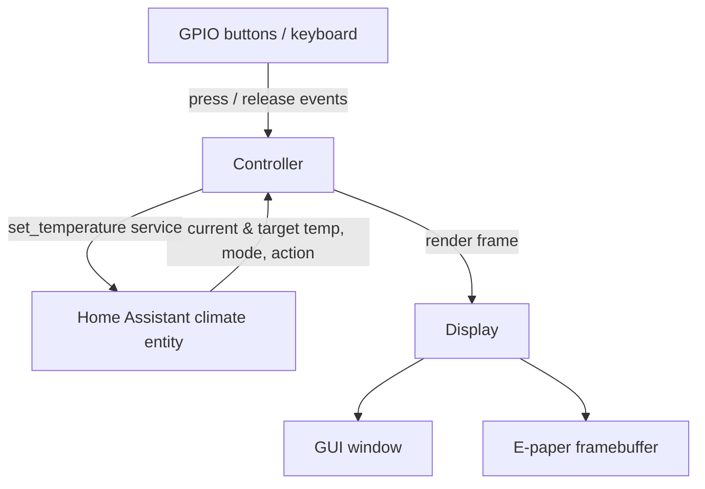

# Thermostat

A Home Assistant thermostat **interface** written in Go, designed to run on a
small 5" e-paper display with GPIO buttons.

It is deliberately a *pure interface*: it **never decides** when to heat or
cool. It reads a Home Assistant climate entity (for example the built-in
`generic_thermostat` integration), displays its state, and forwards user
temperature adjustments back to Home Assistant. All heating/cooling logic lives
in Home Assistant.

## Features

- **Development GUI window** that emulates the e-paper screen (Ebiten, no cgo).
- **Keyboard controls** during development: ↑/↓ adjust the target, **hold to
  auto-repeat**, `q`/`Esc` quits.
- Reads a **generic thermostat entity** in Home Assistant for its state — the
  current room temperature, target, mode, and HVAC action all come from Home
  Assistant.
- Optionally reads a **separate outside temperature entity** and shows it in the
  bottom-left corner.
- UI laid out for a **5" e-paper display** (800×480 by default, B/W "ink" style).
- **Waveshare three-color e-paper** (black/white/red and black/white/yellow)
  driven directly over SPI — see the Hardware section.
- **GPIO buttons** for increase/decrease with **press-and-hold** auto-repeat
  (Linux sysfs, standard library only).
- **Full-screen temperature** when the target changes; it clears and shows the
  new value large with the current room temperature as helper text.
- Standard library as much as possible: HTTP/JSON, flags, GPIO sysfs, and the
  framebuffer renderer all use `net/http`, `encoding/json`, `flag`, `os`, and a
  hand-drawn bitmap font. The only external dependency is Ebiten (GUI window,
  cgo-free).

## How it works



- Every `poll` interval the controller reads the climate entity's current
  temperature, target temperature, mode, and HVAC action.
- A press changes the target by `step` degrees; holding a button auto-repeats
  after `hold.delay` at `hold.repeat`. Each change calls Home Assistant's
  `climate.set_temperature` service and shows the new value full screen for
  `edit.timeout`.

## Prerequisites

- Go (the module targets the toolchain in `go.mod`).
- For the development GUI, Ebiten loads native libraries (GLFW, OpenGL, X11) at
  runtime through `github.com/ebitengine/purego` — **no cgo is required to
  build**. On Debian/Ubuntu install the runtime libraries with:
  `sudo apt install libglfw3 libgl1-mesa-dev xorg-dev`.
- A Home Assistant instance with a long-lived access token.

The whole project builds with `CGO_ENABLED=0` (see the `Makefile`).

## Build & run

Run `go mod tidy` to finalize the dependency graph and generate `go.sum`:

```sh
go mod tidy
```

Development mode (GUI window + keyboard). Pass `-display.accent red` (or
`yellow`) to preview the three-color target temperature in the window:

```sh
CGO_ENABLED=0 go run . -dev \
  -ha.url http://your-home-assistant:8123 \
  -ha.token YOUR_LONG_LIVED_TOKEN
```

Device build (no GUI, writes to a framebuffer-backed e-paper panel):

```sh
CGO_ENABLED=0 go build -o thermostat .
./thermostat -dev=false -display.device /dev/fb0
```

Run the standard-library-only unit tests:

```sh
go test ./internal/fb/...
```

## Home Assistant setup

1. Create a long-lived access token (Profile → Security → Long-lived access
   tokens).
2. Create a `generic_thermostat` (or use any climate entity) and configure it
   with its own target temperature sensor in Home Assistant. The thermostat
   reads the climate entity's `current_temperature`, so no sensor reporting
   from this program is needed.
3. Run the program with `-ha.thermostat climate.your_entity`.

## Hardware

### Buttons

Two momentary buttons between a GPIO pin and ground (active-low with internal
pull-ups is the common arrangement). Defaults are BCM 17 (increase) and BCM 27
(decrease). Enable with:

```sh
-buttons.enabled -buttons.up 17 -buttons.down 27
```

Buttons use the legacy sysfs GPIO interface (`/sys/class/gpio`). If your kernel
does not expose it, the program logs a warning and runs without buttons.

### E-paper panel

Two device backends are available (select with `-display.driver`):

**Framebuffer** (default) writes raw pixels to a Linux framebuffer device. For a
5" panel, use a framebuffer driver such as `fbtft` or `epdiy` that exposes the
panel at `/dev/fb0`, and select the matching pixel format with
`-display.format` (`gray8`, `rgb565`, or `mono`).

**Waveshare** drives a three-color (black/white/red or black/white/yellow)
panel directly over SPI using the panel's Data/Command, reset, and busy GPIO
lines. It targets the SSD1680-class command set shared by Waveshare's "B"
panels (4.2", 5.65", 5.83", and 7.5"):

```sh
./thermostat -dev=false \
  -display.driver waveshare \
  -display.panel 7in5b_v2 \
  -display.accent red \
  -display.spi.device /dev/spidev0.0 \
  -display.gpio.dc 25 -display.gpio.reset 17 -display.gpio.busy 24
```

`-display.panel` supplies the resolution (see the flag table). The accent
(`red` or `yellow`) is used for the target temperature; the rest of the UI stays
black. The same accent is previewed in the development window. The init
sequence is the standard Waveshare SSD1680 reference and is parameterised by
resolution, so an unusual panel revision may need a custom sequence in
`internal/waveshare/panel.go`.

> The panel's native orientation must match the UI (landscape). Portrait
> panels would additionally need a rotation step in the driver.

### Buttons
## Configuration flags

Run `./thermostat -h` for the full list. Notable flags:

| Flag | Default | Description |
| --- | --- | --- |
| `-dev` | `true` | GUI window + keyboard; `false` uses the framebuffer device |
| `-display.width` / `-display.height` | `800` / `480` | Panel resolution |
| `-display.format` | `gray8` | `gray8`, `rgb565`, `mono` (framebuffer) |
| `-display.driver` | `framebuffer` | `framebuffer` or `waveshare` (device builds) |
| `-display.panel` | *(empty)* | Waveshare preset, e.g. `7in5b_v2`, `5in83b_v2`, `4in2b_v2` |
| `-display.accent` | `red` | Accent color for three-color panels: `red`, `yellow` |
| `-display.spi.device` | `/dev/spidev0.0` | SPI device for Waveshare |
| `-display.spi.speed` | `4000000` | SPI clock speed in Hz |
| `-display.gpio.dc` / `.reset` / `.busy` | `25` / `17` / `24` | Waveshare control GPIO pins (BCM) |
| `-display.gpio.busy_active_low` | `false` | Busy signal is active-low |
| `-ha.url` | `http://homeassistant.local:8123` | Home Assistant URL |
| `-ha.token` | *(env `THERMOSTAT_HA_TOKEN`)* | Long-lived access token |
| `-ha.thermostat` | `climate.thermostat` | Climate entity id |
| `-ha.outside` | *(empty)* | Outside temperature (sensor) entity id; empty hides the readout |
| `-step` | `0.5` | Degrees per press |
| `-edit.timeout` | `3s` | Full-screen duration after a change |
| `-hold.delay` | `400ms` | Hold time before auto-repeat begins |
| `-hold.repeat` | `200ms` | Auto-repeat interval while held |
| `-buttons.enabled` | `false` | Enable GPIO buttons |

## Package layout

- `cmd/thermostat` — entrypoint and wiring.
- `internal/config` — flag/env loading.
- `internal/state` — shared display/snapshot model.
- `internal/input` — press/release events and sysfs GPIO buttons.
- `internal/homeassistant` — REST API client (stdlib).
- `internal/fb` — framebuffer, bitmap font, layout renderer, device writer.
- `internal/waveshare` — SPI driver for Waveshare three-color e-paper panels.
- `internal/display` — Ebiten development window (cgo-free).
- `internal/controller` — the event loop that ties it together.
